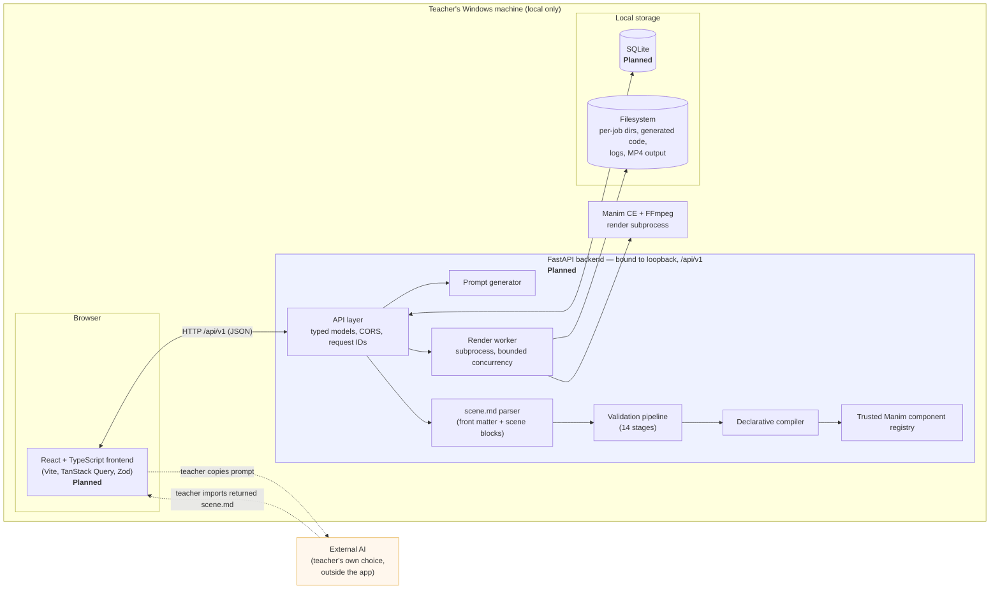
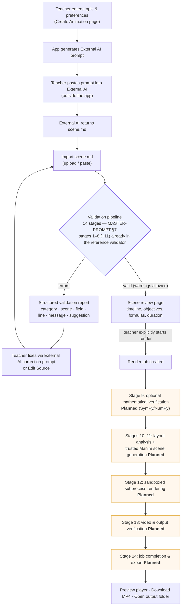
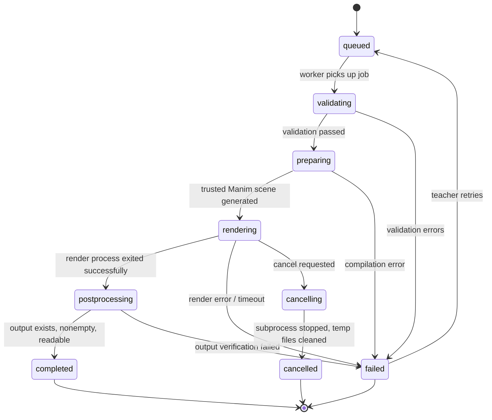

# MathMotion Studio — Architecture

> **Status of this document:** The application (FastAPI backend, React frontend, Manim renderer, PowerShell launcher, SQLite storage) is **planned, not yet implemented**. Everything below that is marked *Planned* describes the target architecture defined in [`MASTER-PROMPT.md`](../MASTER-PROMPT.md). What exists today is the Scene format specification, its JSON Schemas, example scenes, prompt templates, and the reference validator — see [Current implementation status](#current-implementation-status). Follow [`docs/ROADMAP.md`](ROADMAP.md) for the build sequence.

Companion documents: [`docs/TECH_STACK.md`](TECH_STACK.md) (technologies), [`docs/DATA_MODEL.md`](DATA_MODEL.md) (scene format and persistence), [`prompts/SCENE_FORMAT_SPEC.md`](../prompts/SCENE_FORMAT_SPEC.md) (canonical Scene format), [`prompts/SCENE_VALIDATION_RULES.md`](../prompts/SCENE_VALIDATION_RULES.md) (validation rules), [`docs/TESTING.md`](TESTING.md).

---

## 1. System overview

MathMotion Studio is a local-first, AI-assisted mathematics animation studio for school teachers. The teacher never writes code and never talks to a terminal after launch:

1. The teacher runs `run.ps1`; a browser dashboard opens.
2. The teacher enters a topic, grade, language, duration, and preferences; the app generates a complete, topic-specific AI prompt.
3. The teacher copies the prompt into **any External AI** (not integrated — no API key, account, or cloud service is part of the app) and receives a `scene.md` file.
4. The teacher imports `scene.md`; the app parses and validates it.
5. The teacher reviews the scene plan, picks a quality, and starts the render.
6. The app compiles validated scene actions into trusted Manim components and renders an MP4.
7. The teacher previews and exports the video.

Three architectural principles drive every component:

- **Declarative, never executable.** The Scene format contains no code. A validated `scene.md` is translated by a declarative compiler into a limited set of trusted Manim components. The app never runs AI-generated Python, never uses `eval`/unrestricted `exec`, and never imports user-supplied modules ([`MASTER-PROMPT.md` §6](../MASTER-PROMPT.md)).
- **Local-first.** SQLite for metadata, filesystem for videos and logs, loopback-only networking, no cloud dependencies, no authentication, no telemetry.
- **Honest and strict.** Unsupported instructions are rejected with located, actionable errors — never silently dropped, never guessed at. Syntax validation and mathematical verification are reported separately; a successful render never implies the mathematics was verified ([`prompts/SCENE_VALIDATION_RULES.md` §4](../prompts/SCENE_VALIDATION_RULES.md)).

### Component diagram (planned architecture)



The **External AI is deliberately outside every trust and network boundary**: the application never contacts an AI service. The teacher carries the prompt out and the `scene.md` back by hand.

---

## 2. Component responsibilities

All components in this table are **Planned / not yet implemented** unless stated otherwise.

| Component | Responsibility | Notes |
|---|---|---|
| **React frontend** | Sidebar navigation (Home, Create Animation, Import Scene, My Animations, Rendering Jobs, Settings, Help); prompt-builder form with live prompt preview and clipboard/download actions; `scene.md` import (drag-and-drop, file picker, paste) with validation report display; scene review; video preview player; job monitoring; lesson history; settings and dependency-health display. | Never fabricates statistics or fake jobs. All state changes go through `/api/v1`. See [`docs/UI_UX_SPEC.md`](UI_UX_SPEC.md). |
| **FastAPI backend** | Versioned `/api/v1` HTTP API; typed Pydantic request/response models; upload limits; CORS restricted to the local frontend; request IDs and structured logging; safe path handling; resource limits; binds to loopback by default. Serves the built frontend in production mode. | No general-purpose shell or Python-execution endpoint is ever exposed. |
| **Prompt generator** | Composes a complete, self-contained External AI prompt from the teacher's form inputs, incorporating the canonical Scene format specification — not an invented schema. Supports full and compact prompt variants; copy and download as `.txt`. | Never pretends to generate the AI response itself. |
| **scene.md parser** | Splits `scene.md` into YAML front matter and Markdown body; extracts fenced ` ```scene ` blocks; loads YAML with a *safe* loader only; produces structured lesson + scene models. | Mirrors the parsing already implemented in [`tools/validate_scene.py`](../tools/validate_scene.py) (implemented). |
| **Validation pipeline** | The 14-stage pipeline of [`MASTER-PROMPT.md` §7](../MASTER-PROMPT.md) — see §4 below. Emits structured errors (category, scene id, field path, source line, message, suggestion) and separate warnings. | Stages 1–9 and 11 (in the numbering of [`prompts/SCENE_VALIDATION_RULES.md`](../prompts/SCENE_VALIDATION_RULES.md)) are already implemented in the reference validator (implemented). |
| **Trusted Manim component registry** | A fixed, extensible catalogue of safe components: text/formula/equation objects, geometry (points, lines, triangles, circles, polygons, …), graphs (axes, function graphs, area fills, number lines), animation primitives (create, write, transform, move, …), plus shared layout helpers for positioning, margins, colors, and transitions. Maps 1:1 to the Scene format's 19 object kinds and 15 action types. | Adding a component means adding to the registry — never accepting code from a file. |
| **Declarative compiler** | Translates a validated scene model into Manim scene classes by calling typed registry functions. No string interpolation of untrusted text into executable Python; explicit mapping from schema actions to trusted implementation functions. | Output is per-job generated code, stored for diagnostics. |
| **Render worker** | Runs renders in a **subprocess** (never on the FastAPI event loop) with bounded concurrency; captures stdout/stderr per job; reports progress (honest indeterminate indicator when Manim cannot report exact progress); supports cancellation, timeouts, retries; verifies output files before marking a job completed; persists job state so a backend restart never marks an incomplete job successful. | See §5 for the job state machine. |
| **SQLite storage** | Metadata and job records only: lessons, render jobs, settings. Video binaries stay out of the database. | See [`docs/DATA_MODEL.md`](DATA_MODEL.md) §6 — *planned; no database exists yet*. |
| **Filesystem storage** | Source `scene.md` files, generated Manim code, per-job logs, temporary render artifacts (isolated per-job directories), and final MP4 outputs under a configurable output directory. | Safe filenames; no path traversal; no deletion outside configured application directories. |
| **`run.ps1` launcher** *(planned)* | Environment checks (Windows, PowerShell, Python, Node/npm, FFmpeg, optional LaTeX); creates/uses a Python virtual environment; installs dependencies; verifies port availability; starts the backend; waits for the health endpoint; opens the default browser; tracks and cleanly shuts down child processes. Modes: default, `-Setup`, `-Dev`, `-Diagnostics`. | Never kills unrelated processes; never requires administrator privileges. See [`docs/INSTALLATION.md`](INSTALLATION.md). |

---

## 3. Frontend ↔ backend communication *(planned)*

All communication is HTTP + JSON under a versioned prefix **`/api/v1`**, with typed Pydantic models on the server and Zod validation on the client. Exact route paths are defined when the backend is scaffolded; [`MASTER-PROMPT.md` §9](../MASTER-PROMPT.md) fixes the required capabilities:

| Capability | Purpose |
|---|---|
| Health and dependency checks | Launcher readiness probe; Settings-page dependency status (Manim, FFmpeg, LaTeX availability). |
| Prompt generation | Turn the teacher's form into a complete External AI prompt. |
| Schema documentation and example scenes | Serve the Scene format reference and bundled example `scene.md` files. |
| Scene upload and validation | Accept a `.md` upload (or pasted text), run the validation pipeline, return the structured report. |
| Scene source retrieval | Fetch the stored original Markdown for Edit Source / re-download. |
| Render job creation | Start a render for a validated scene (never before validation succeeds and the teacher explicitly starts it). |
| Render job status | Poll job state, phase, and honest progress. |
| Render logs | Per-job captured stdout/stderr for the collapsible technical panel. |
| Render cancellation | Request cancellation of a queued or running job. |
| Video streaming / download | Play the MP4 in the preview page; download it. |
| Lesson history / deletion | List, search, and delete stored lessons and their outputs (with confirmation). |
| Settings retrieval and updates | Output directory, default quality/aspect ratio, theme, language — persisted locally. |
| Output directory opening | Open the output folder in Explorer where safely supported. |

Cross-cutting rules: CORS restricted to the local frontend; upload size limits; consistent error responses with request IDs; **loopback binding by default**; state-changing operations protected against unintended cross-origin requests; uploaded Markdown is treated as untrusted input everywhere. There is **no** endpoint that executes arbitrary Python or shell commands.

---

## 4. Scene import → validation → render → preview lifecycle

The end-to-end flow combines the teacher workflow with the application pipeline:



### 4.1 The 14-stage validation pipeline

Stages as defined in [`MASTER-PROMPT.md` §7](../MASTER-PROMPT.md). The right-hand column maps each stage to the reference validator's own stage numbering in [`prompts/SCENE_VALIDATION_RULES.md`](../prompts/SCENE_VALIDATION_RULES.md) §1 and states what is actually implemented today in [`tools/validate_scene.py`](../tools/validate_scene.py).

> **Numbering note:** `MASTER-PROMPT.md` §7 numbers the *application* pipeline 1–14; `SCENE_VALIDATION_RULES.md` numbers the *validation rules* 1–12 (10 = mathematical verification, 12 = layout & compile). The two schemes are not identical; the mapping below makes the correspondence explicit.

| # (MP §7) | Stage | Validation-rules stage | Status in `tools/validate_scene.py` |
|---|---|---|---|
| 1 | File upload and size validation | 1 File intake | **Implemented** — 512 KB size cap (the HTTP upload itself is app-only). |
| 2 | Safe Markdown parsing | 2 Encoding, 3 Front-matter split | **Implemented** — UTF-8 with BOM tolerance; `---` front-matter delimiters required. |
| 3 | Front matter or metadata parsing | 3–4 (YAML parse) | **Implemented** — `yaml.safe_load` only; no object construction. |
| 4 | Schema version validation | 5 Schema version | **Implemented** — accepts only `schema_version: "1.0"`. |
| 5 | Pydantic schema validation | 6–7 (JSON Schemas) | **Implemented** — via `jsonschema` Draft 2020-12 against both schemas; the app will express the same rules as Pydantic models. |
| 6 | Unsupported component and action checks | 7 Scene schema | **Implemented** — closed enums for the 19 object kinds / 15 action types; `additionalProperties: false` rejects unknown fields. |
| 7 | Mathematical parameter validation | 8 Reference & semantics, 9 Expression safety | **Implemented** — ids, targets, `write`-kind matching, `transform.into`, `axes` requirements, colors, frame bounds, timing; AST-allowlist expression checking (never `eval`). |
| 8 | Resource-limit checks | 11 Resource limits | **Implemented** — per-file 512 KB cap plus schema `maxItems` caps (40 objects, 120 actions, 10 verification assertions, 12 markers, …). |
| 9 | Optional mathematical verification | 10 Mathematical verification | **Planned** — evaluating front-matter `verification` assertions with SymPy/NumPy, reported separately from syntax. |
| 10 | Scene planning and layout analysis | 12 (layout part) | **Planned**. |
| 11 | Trusted Manim scene generation | 12 (compile part) | **Planned**. |
| 12 | Sandboxed rendering | 12 (render part) | **Planned** — subprocess-based render worker. |
| 13 | Video and output verification | — | **Planned** — output exists, nonempty, readable before a job may complete. |
| 14 | Job completion and export | — | **Planned**. |

A failure stops the pipeline at its stage; the teacher never sees a partial render caused by a later-stage problem. Errors and warnings are always reported separately, and a scene with warnings can still render.

---

## 5. Render job lifecycle and states *(planned)*

Every render is a **Render job** with a persisted state so the UI can recover from backend restarts without mislabeling incomplete jobs as successful ([`MASTER-PROMPT.md` §8](../MASTER-PROMPT.md)):



| State | Meaning |
|---|---|
| `queued` | Job accepted and persisted; waiting for a worker slot (bounded concurrency). |
| `validating` | Validation pipeline re-runs on the stored source; render never starts from an unvalidated scene. |
| `preparing` | Declarative compiler generates the trusted Manim scene code in the job's isolated directory. |
| `rendering` | Manim/FFmpeg subprocess is running; stdout/stderr captured per job. |
| `postprocessing` | Render finished; output file is being checked and finalized. |
| `completed` | Output verified (exists, nonempty, readable); paths recorded; MP4 ready for preview/export. |
| `failed` | Any stage failed; a teacher-facing message plus expandable technical diagnostics are stored. |
| `cancelling` | Cancellation requested; subprocess being stopped. |
| `cancelled` | Subprocess stopped, temporary files cleaned; no output is offered. |

Error handling rules: timeouts abort to `failed`; retry re-queues the job; where Manim cannot report exact progress the UI shows an **honest indeterminate indicator**, never fabricated percentages; full stack traces stay in the technical panel, never in the normal teacher-facing message.

---

## 6. Temporary files, output, configuration, and process management *(planned)*

- **Per-job isolation.** Generated Manim code, logs, and intermediates live in a unique per-job directory; cleanup runs on completion, failure, and cancellation.
- **Output management.** Final MP4s go to a configurable output directory with safe filenames; large videos are never stored in SQLite. Path traversal, arbitrary overwrites, and deletions outside application directories are prevented.
- **Configuration.** Output directory, default quality (preview/standard/high), default aspect ratio (16:9 / 9:16 / 1:1), theme, and language are persisted locally (SQLite) and editable on the Settings page; changing the output directory is validated before it is stored.
- **Process management.** `run.ps1` determines the project root from its own location, checks Windows/PowerShell/Python/Node/FFmpeg (LaTeX optional), creates a Python virtual environment on demand, installs backend and frontend dependencies as needed, builds the frontend for production mode, verifies the chosen local port is free **without killing unrelated processes**, starts the backend (Uvicorn) with the virtual environment's interpreter, waits for the `/api/v1` health endpoint, opens the default browser, and shuts down its child processes cleanly on exit or Ctrl+C. Diagnostics: `-Setup`, `-Dev`, `-Diagnostics` modes. See [`docs/INSTALLATION.md`](INSTALLATION.md).

---

## 7. Current implementation status

**Today the following exist and are real, working artifacts:**

| Artifact | What it is |
|---|---|
| [`schema/lesson-metadata-v1.schema.json`](../schema/lesson-metadata-v1.schema.json) | JSON Schema (draft 2020-12) for `scene.md` YAML front matter, Scene format v1.0. |
| [`schema/scene-v1.schema.json`](../schema/scene-v1.schema.json) | JSON Schema (draft 2020-12) for a single ` ```scene ` block: 19 object kinds, 15 action types. |
| [`tools/validate_scene.py`](../tools/validate_scene.py) | Reference validator implementing validation stages 1–9 and 11 (validation-rules numbering): intake, encoding, front-matter split, safe YAML parse, schema version, both JSON schemas, reference/semantic checks, AST-based expression safety, resource caps. Human-readable and `--json` reports; exit codes 0/1/2. |
| [`prompts/SCENE_FORMAT_SPEC.md`](../prompts/SCENE_FORMAT_SPEC.md) | Canonical human-readable Scene format specification. |
| [`prompts/SCENE_VALIDATION_RULES.md`](../prompts/SCENE_VALIDATION_RULES.md) | Validation rules and error taxonomy the application must implement. |
| [`prompts/`](../prompts/) prompt templates + [`prompts/examples/`](../prompts/examples/) | Reusable External AI prompts and nine example scenes, all machine-validated by the reference validator. |

**The following do not exist yet** (all *Planned*): the FastAPI backend and its `/api/v1` API, the React frontend, the scene parser as an application module, the trusted Manim component registry, the declarative compiler, the render worker and job lifecycle, SQLite persistence, `run.ps1` / `stop.ps1`, and any rendered MP4 output. Stage 9 (mathematical verification) and stages 10–14 (planning, code generation, sandboxed rendering, output verification, completion/export) are unimplemented by design at this point. Progress and sequencing: [`docs/ROADMAP.md`](ROADMAP.md). Test strategy, including the documentation consistency routine that runs the reference validator over every example scene: [`docs/TESTING.md`](TESTING.md). Data structures: [`docs/DATA_MODEL.md`](DATA_MODEL.md).
