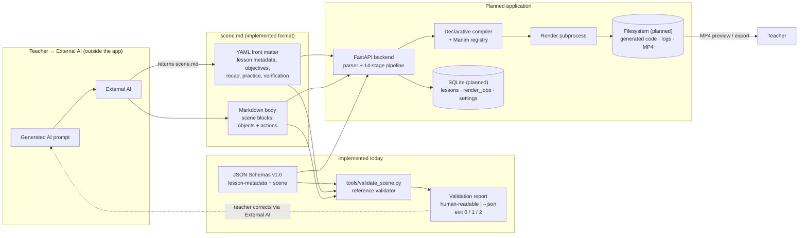

# MathMotion Studio — Data model

> **Status:** The structures in §2–§4 (the Scene format and the reference validator's report) are **implemented and machine-verified today**. The database tables in §5 are **Planned / not yet implemented — no database exists yet**; they describe the persistence defined in [`MASTER-PROMPT.md` §12](../MASTER-PROMPT.md) for the future application.

Canonical format specification: [`prompts/SCENE_FORMAT_SPEC.md`](../prompts/SCENE_FORMAT_SPEC.md). Machine-readable schemas: [`schema/lesson-metadata-v1.schema.json`](../schema/lesson-metadata-v1.schema.json) and [`schema/scene-v1.schema.json`](../schema/scene-v1.schema.json). Reference validator: [`tools/validate_scene.py`](../tools/validate_scene.py). Architecture context: [`docs/ARCHITECTURE.md`](ARCHITECTURE.md).

---

## 1. Overview

MathMotion Studio has two data domains:

1. **The Scene format (`scene.md`)** — a versioned, declarative Markdown+YAML document that an **External AI** produces and the teacher imports. Defined by JSON Schemas (draft 2020-12) for **v1.0**; validated today by the reference validator. This is the primary data contract of the product.
2. **Application persistence (Planned)** — SQLite records for lessons, Render jobs, and settings, plus filesystem storage for sources, generated code, logs, and MP4 outputs. Not implemented.

Terminology used throughout: **scene.md** (the teacher-importable file), **Scene format** (the declarative format itself), **Render job** (an animation-rendering task), **External AI** (the teacher's own AI tool, outside the application).

---

## 2. The `scene.md` file (implemented format)

A `scene.md` file has exactly two parts ([`SCENE_FORMAT_SPEC.md` §2](../prompts/SCENE_FORMAT_SPEC.md)):

```text
---                     ← YAML front matter (lesson metadata, §3 below)
...YAML...
---                     ← closing delimiter
                        ← Markdown body: optional free prose (never rendered)
                        ← followed by fenced ```scene blocks (§4 below), in playback order
```

File-level constraints: UTF-8 (optional BOM), maximum **512 KB** (larger files are rejected before parsing), front matter must start the file, scene blocks are fenced code blocks whose info string is exactly `scene`. Comments (YAML `# ...` and Markdown `<!-- ... -->`) are ignored by the renderer.

---

## 3. Front matter — lesson metadata (implemented)

Validated against [`lesson-metadata-v1.schema.json`](../schema/lesson-metadata-v1.schema.json) (draft 2020-12; `additionalProperties: false` — unknown keys are rejected so typos never silently discard intent).

### 3.1 Top-level fields

| Field | Required | Type / rules | Default |
|---|---|---|---|
| `schema_version` | yes | const `"1.0"` | — |
| `lesson` | yes | object, see §3.2 (requires `title`, `topic`, `grade`, `language`) | — |
| `objectives` | no | string[], 0–10 items, each 1–200 chars | `[]` |
| `prerequisites` | no | string[], 0–10 items, each 1–200 chars | `[]` |
| `recap` | no | string, 1–1000 chars | — |
| `practice_questions` | no | string[], 0–12 items, each 1–300 chars | `[]` |
| `verification` | no | assertion objects, 0–10, see §3.3 | `[]` |

### 3.2 `lesson` object

| Field | Required | Type / rules | Default |
|---|---|---|---|
| `title` | yes | string, 1–140 chars | — |
| `topic` | yes | string, 1–140 chars | — |
| `grade` | yes | string, 1–24 chars (e.g. `"8"`, `"11–12"`) | — |
| `language` | yes | Full language name (`English`, `Bengali`) or BCP-47 tag matching `^(?:[a-z]{2,3}(?:-[A-Za-z0-9]{2,8})?\|[^0-9\s][^0-9]{1,39})$` (`en`, `de`, `pt-BR`), 2-40 characters | — |
| `duration_minutes` | no | number, 1–60 | `5` |
| `aspect_ratio` | no | `"16:9"` \| `"9:16"` \| `"1:1"` | `"16:9"` |
| `theme` | no | `midnight` \| `ivory` | `midnight` |

The `aspect_ratio` choice fixes the visible frame used by validation and rendering: `16:9` → x ∈ [−7, 7], y ∈ [−4, 4]; `9:16` → x ∈ [−4, 4], y ∈ [−7, 7]; `1:1` → x and y ∈ [−4.5, 4.5] ([`SCENE_FORMAT_SPEC.md` §7.1](../prompts/SCENE_FORMAT_SPEC.md)).

### 3.3 `verification` assertion (optional mathematical checks)

Assertions are evaluated **separately from rendering** (planned stage 9); passing validation never implies mathematical verification.

| Field | Required | Type / rules |
|---|---|---|
| `id` | yes | `^[a-z][a-z0-9_-]{0,39}$`, unique among assertions |
| `kind` | yes | `numeric` \| `symbolic` (symbolic uses SymPy simplification — planned) |
| `description` | yes | string, 1–200 chars |
| `expression` | yes | restricted math grammar, 1–200 chars (§4.4) |
| `expected` | yes | number (`0` for "identically zero" identities) |
| `tolerance` | no | number > 0, default `1e-9` |
| `subs` | no | map of variable → finite number, e.g. `{a: 3, b: 4, c: 5}` |

### 3.4 Representative front-matter example

Adapted from [`lesson-metadata-v1.schema.json`](../schema/lesson-metadata-v1.schema.json) and the canonical Pythagorean example ([`SCENE_FORMAT_SPEC.md` §3](../prompts/SCENE_FORMAT_SPEC.md)):

```yaml
---
schema_version: "1.0"
lesson:
  title: The Pythagorean Theorem
  topic: Pythagorean theorem
  grade: "8"
  language: English
  duration_minutes: 5
  aspect_ratio: "16:9"
  theme: midnight
objectives:
  - State the Pythagorean theorem for a right triangle.
  - Verify the relationship on a 3-4-5 triangle.
prerequisites:
  - Squares of whole numbers
  - The concept of a right angle
recap: >-
  For any right triangle with legs a and b and hypotenuse c,
  a² + b² = c². The relation holds only for right triangles.
practice_questions:
  - A right triangle has legs 6 and 8. Find the hypotenuse.
verification:
  - id: v1
    kind: numeric
    description: The 3-4-5 triangle satisfies the theorem.
    expression: 3**2 + 4**2 - 5**2
    expected: 0
---
```

---

## 4. Scene blocks (implemented)

Validated against [`scene-v1.schema.json`](../schema/scene-v1.schema.json). Each scene is one fenced block in playback order.

### 4.1 Scene fields

| Field | Required | Type / rules | Default |
|---|---|---|---|
| `id` | yes | `^[a-z][a-z0-9_-]{0,39}$`, unique across all scene blocks in the file | — |
| `title` | yes | string, 1–140 chars | — |
| `type` | yes | `intro` \| `explanation` \| `worked_example` \| `proof` \| `recap` \| `practice` | — |
| `duration` | no | number, 0.5–300 s | computed: latest action start + duration + 1.5 s tail |
| `narration` | no | string, 1–2000 chars (voiceover/subtitle source text; never rendered on screen by itself) | — |
| `objects` | no | 0–40 objects, see §4.2 (ids unique within the scene) | `[]` |
| `actions` | no | 0–120 ordered actions, see §4.3 | `[]` |

### 4.2 Object kinds — 19 kinds with per-kind parameters

Every object requires `id` and `kind`; `params` is kind-specific (`additionalProperties: false` per kind via conditional schema). Shared parameter vocabulary: `position`/`start`/`end`/`vertex`/`center`/`origin`/`to` are `[x, y]` scene coordinates (each −50…50); `color` is a palette name (`navy`, `violet`, `ivory`, `white`, `black`, `gray`, `red`, `green`, `blue`, `amber`, `teal`, `pink`) or `#RRGGBB`; `stroke_width` 1–12; `fill_opacity` 0–1; `font_size` 16–120; `label` 1–40 chars.

| Kind | Required params | Optional params (constraints / defaults) |
|---|---|---|
| `text` | `content` (1–200 chars) | `font_size` (16–120, default 36), `color`, `position` |
| `formula` | `content` (1–200 chars) | `renderer` (`auto`/`text`/`latex`, default `auto`), `font_size` (16–96, default 44), `color`, `position` |
| `equation` | `content` (3–200 chars, must contain `=`) | `font_size` (16–96, default 40), `color`, `position` |
| `point` | `position` | `radius` (0.05–0.5, default 0.12), `color`, `label`, `label_direction` (`up`/`down`/`left`/`right`, default `up`) |
| `segment` | `start`, `end` | `color`, `stroke_width`, `label` |
| `line` | `start`, `end` | `color`, `stroke_width`, `label` (infinite line through the points, clipped to the frame) |
| `ray` | `start`, `end` | `color`, `stroke_width`, `label` |
| `angle` | `vertex`, `start_angle`, `end_angle` (degrees, −360…360) | `radius` (0.2–2, default 0.8), `color`, `label` |
| `triangle` | `vertices` (exactly 3 `[x, y]`) | `labels` (0–3), `color`, `fill_opacity`, `stroke_width` |
| `circle` | `center`, `radius` (0.1–10) | `color`, `fill_opacity`, `stroke_width` |
| `polygon` | `vertices` (3–12 `[x, y]`) | `labels` (0–12), `color`, `fill_opacity`, `stroke_width` |
| `square` | `origin` (center), `side` (0.1–10) | `angle` (−360…360, default 0), `color`, `fill_opacity`, `stroke_width` |
| `rectangle` | `origin` (center), `width` (0.1–12), `height` (0.1–12) | `angle` (default 0), `color`, `fill_opacity`, `stroke_width` |
| `vector` | `start`, `end` | `color`, `stroke_width`, `label` |
| `axes` | — | `x_range`, `y_range` (value pairs, −50…50), `grid` (default false), `include_numbers` (default true), `x_label`, `y_label` |
| `function_graph` | `expression` (§4.4) | `domain` (pair), `color`, `stroke_width`, `samples` (20–2000, default 400) — requires an `axes` object in the same scene |
| `area_fill` | `expression`, `domain` | `color`, `fill_opacity` (default 0.35) — requires `axes` |
| `number_line` | `range` (value pair, −1000…1000) | `step` (0.05–100, default 1), `markers` (0–12 of `{value, label?, color?}`), `color`, `label` |
| `fraction` | `numerator`, `denominator` (each 1–12 chars) | `font_size` (16–120, default 48), `color`, `position`, `label` |

Kinds planned for a later minor version are rejected in v1.0 with a helpful error, never silently ignored ([`SCENE_FORMAT_SPEC.md` §6.1](../prompts/SCENE_FORMAT_SPEC.md)).

### 4.3 Action types — 15 actions with per-action fields

Every action has a discriminator `action`; `wait` is the only action without a target. Common optional fields: `at` (start seconds, 0–600; auto-sequenced when omitted) and `duration` (0.1–60; per-action defaults — most 1 s, `write` 2 s, `wait` 1 s, `reveal` = interval × count).

| Action | Required fields | Optional fields |
|---|---|---|
| `create` | `target` (single or list) | `at`, `duration` (with `duration` → fade in) |
| `write` | `target` (**single** — a `text`/`formula`/`equation` object) | `at`, `duration` |
| `fade_in` | `target` (single or list) | `at`, `duration` |
| `fade_out` | `target` (single or list) | `at`, `duration` |
| `transform` | `target` (**single**), `into` (declared-but-hidden object id) | `at`, `duration` |
| `move` | `target` (**single**), `to` (`[x, y]`) | `at`, `duration` |
| `rotate` | `target` (**single**), `degrees` (−360…360) | `at`, `duration` |
| `scale` | `target` (**single**), `factor` (0.05–20) | `at`, `duration` |
| `indicate` | `target` (**single**) | `at`, `duration`, `style` (`pulse`/`highlight`/`underline`) |
| `circumscribe` | `target` (**single**) | `at`, `duration`, `color` |
| `draw_border` | `target` (**single**) | `at`, `duration`, `color` |
| `recolor` | `target` (**single**), `color` | `at`, `duration` |
| `wait` | — | `at`, `duration` |
| `arrange` | `target` (**array**, 2–24 ids), `layout` (`row`/`column`/`grid`) | `at`, `duration`, `gap` (0.1–5), `to` (group center) |
| `reveal` | `target` (**array**, 1–24 ids) | `at`, `duration`, `interval` (0.1–10) |

Targets are object ids declared in the same scene's `objects`; `idList` targets hold 1–24 unique ids. Any field not listed for an action is rejected (`additionalProperties: false`) — strictness is deliberate so invented fields never hide errors until render time ([`SCENE_FORMAT_SPEC.md` §5](../prompts/SCENE_FORMAT_SPEC.md)).

### 4.4 Math expression grammar

`function_graph.expression`, `area_fill.expression`, and verification `expression` strings (1–120 chars for object params) may contain only: decimal numbers; the variable `x` (graphs) or `subs`-bound variables (assertions); operators `+ - * / **` (`^` is an alias for `**`) and parentheses; constants `pi`, `e`; and the function allowlist `sin cos tan asin acos atan sqrt abs ln log log10 exp floor ceil round min max`. The validator enforces this via a Python `ast` allowlist — it **never calls `eval`** — and rejects any other syntax with category `unsafe_expression` ([`SCENE_FORMAT_SPEC.md` §7.4](../prompts/SCENE_FORMAT_SPEC.md)).

### 4.5 Representative scene-block example

Adapted from [`scene-v1.schema.json`](../schema/scene-v1.schema.json) and the canonical example ([`SCENE_FORMAT_SPEC.md` §4](../prompts/SCENE_FORMAT_SPEC.md)):

````markdown
```scene
id: s1
title: A right triangle and its squares
type: explanation
duration: 24
narration: >-
  Here is a right triangle. Its two legs are a and b,
  and the longest side, facing the right angle, is c.
objects:
  - id: tri
    kind: triangle
    params:
      vertices: [[-3, -2], [1, -2], [-3, 1.5]]
      labels: [A, B, C]
      color: ivory
  - id: caption
    kind: text
    params:
      content: "a² + b² = c²"
      position: [3.5, 3]
      font_size: 44
      color: violet
actions:
  - action: create
    target: tri
    at: 0
  - action: write
    target: caption
    at: 4
  - action: indicate
    target: tri
    style: pulse
    at: 9
    duration: 2
```
````

---

## 5. Reference validator output model (implemented)

[`tools/validate_scene.py`](../tools/validate_scene.py) produces a **validation report** with two severities: errors block an import; warnings never do (a scene with warnings can still render).

### 5.1 Issue record

Every issue — error or warning — is a structured record:

| Field | Type | Meaning |
|---|---|---|
| `severity` | `"error"` \| `"warning"` | Blocking or advisory. |
| `category` | string | Machine-readable failure class (§5.3). |
| `message` | string | Human-readable explanation. |
| `scene` | string \| null | Scene id the issue belongs to, or file-level. |
| `path` | string \| null | Field path inside the document, e.g. `$.lesson.title`. |
| `line` | int \| null | Best-effort source line number. |
| `suggestion` | string \| null | A concrete correction. |

### 5.2 Report

| Field | Type | Meaning |
|---|---|---|
| `file` | string | Path of the validated file. |
| `schema_version` | string \| null | Declared `schema_version`, if parsed. |
| `errors` | issue[] | All error-severity issues. |
| `warnings` | issue[] | All warning-severity issues. |

Two output modes:

- **Human-readable (default):** a `VALID`/`INVALID` header line, then one block per issue with category, `scene.path:line` location, message, and `hint:` suggestion, then the error/warning counts.
- **Structured (`--json`):** the report serialized as indented JSON:

```json
{
  "file": "prompts/examples/pythagorean-theorem.md",
  "schema_version": "1.0",
  "errors": [],
  "warnings": []
}
```

A non-empty report looks like this (adapted from a real validator issue):

```json
{
  "file": "broken-lesson.md",
  "schema_version": "1.0",
  "errors": [
    {
      "severity": "error",
      "category": "unknown_target",
      "message": "action 'write' targets unknown object 'caption'",
      "scene": "s1",
      "path": "actions[].target",
      "line": 57,
      "suggestion": "Declare the object in 'objects' or fix the id."
    }
  ],
  "warnings": []
}
```

**Exit codes:** `0` = valid (warnings allowed), `1` = errors found, `2` = usage or environment error (missing dependencies, no file argument, file not found). `--quiet` suppresses output and sets only the exit code; `--version` prints `scene-format 1.0`.

### 5.3 Issue categories

Implemented today by the reference validator:

| Category | Severity | Meaning |
|---|---|---|
| `file_too_large` | error | File exceeds 512 KB. |
| `encoding` | error | Not valid UTF-8. |
| `missing_front_matter` | error | No `---`-delimited front matter. |
| `yaml_syntax` | error | Front matter or scene block is not valid YAML. |
| `schema_version` | error | Unsupported or missing version. |
| `schema` | error | Field missing, wrong type, out of range, or unknown field present. |
| `duplicate_id` | error | Repeated scene or object id. |
| `unknown_target` | error | Action references an undeclared object (or `transform.into` not declared). |
| `kind_mismatch` | error | Action impossible for the object kind (e.g. `write` on a circle; graph without `axes`). |
| `unsafe_expression` | error | Expression leaves the restricted math grammar. |
| `color_unknown` | error | Color is neither palette name nor `#RRGGBB`. |
| `timing_overflow` | error | Actions exceed the declared scene duration by more than 5 s. |
| `empty_scene` | error | No scene blocks, or a scene with objects but no actions. |
| `out_of_frame` | warning | Position outside the visible frame for the chosen aspect ratio. |
| `unused_object` | warning | Declared object never referenced by an action. |
| `timing_tight` | warning | Declared duration much shorter than the estimated pacing. |
| `transform_target` | warning | `transform` destination is also explicitly created. |

The full taxonomy — including categories reserved for the future application, such as `verification_failed` (planned stage 9) — is defined in [`prompts/SCENE_VALIDATION_RULES.md` §3](../prompts/SCENE_VALIDATION_RULES.md).

---

## 6. Planned application persistence

> **Planned / not yet implemented.** No SQLite database, `data/` directory, or storage module exists yet. The following tables restate the persistence requirements of [`MASTER-PROMPT.md` §12](../MASTER-PROMPT.md); exact schemas, indexes, and migrations are defined when the backend is scaffolded. Videos and other large files stay **outside** SQLite — only paths are stored.

### 6.1 `lessons` table (Planned)

| Column (planned) | Content |
|---|---|
| `lesson_id` | Lesson ID (primary key). |
| `title`, `topic`, `grade`, `language` | Copied from the front matter for listing/search. |
| `original_markdown` | The full original `scene.md` text, so a lesson can be reopened and re-rendered without repeating the External AI step. |
| `schema_version` | The Scene format version of the stored file. |
| `created_at` | Creation timestamp. |
| `last_render_at` | Last-render timestamp. |

### 6.2 `render_jobs` table (Planned)

| Column (planned) | Content |
|---|---|
| Job ID + lesson reference | Identifies the Render job and its lesson. |
| `render_settings` | Quality (preview/standard/high), aspect ratio, frame rate, other settings captured at start. |
| `output_paths` | Paths to the produced MP4 and per-job log/code directories. |
| `job_status` | Lifecycle state: `queued`, `validating`, `preparing`, `rendering`, `postprocessing`, `completed`, `failed`, `cancelling`, `cancelled` (see [`docs/ARCHITECTURE.md`](ARCHITECTURE.md) §5). |
| `error_summary` | Teacher-facing error summary for failed jobs. |
| Timestamps | Created/started/finished timestamps. |

### 6.3 `settings` table (Planned)

Persisted teacher preferences: output directory (validated when changed), default render quality, default aspect ratio, theme, preferred language. Dependency health (Manim/FFmpeg/LaTeX availability) is displayed on the Settings page but computed from the environment, not stored.

### 6.4 Filesystem storage (Planned)

| Location | Content |
|---|---|
| Configurable output directory | Final MP4 exports with safe filenames. |
| Per Render job directory (isolated) | Generated trusted Manim scene code, captured stdout/stderr logs, temporary render artifacts — cleaned up after completion, failure, or cancellation. |
| Application data directory | The SQLite database and stored `scene.md` sources. |

Path traversal, arbitrary overwrites, and deletion outside configured application directories are prevented; backup and cleanup behavior is documented in [`docs/INSTALLATION.md`](INSTALLATION.md) when implemented.

---

## 7. Data flow



The same scene data flows twice through the system: through the **reference validator** (documentation-time verification of prompts, examples, and specs — implemented) and, once the application exists, through the **planned app pipeline** (import → validation → Render job → MP4). Both must implement identical rules so prompt templates, examples, and the application never disagree ([`prompts/SCENE_VALIDATION_RULES.md`](../prompts/SCENE_VALIDATION_RULES.md)).
